# 智慧施工安全智能体：技术栈、设计模式与 UML 架构文档

> **文档说明**：本文档基于当前仓库源码（`agent/`、`perception/`、`web/`、`scripts/`）梳理，全面总结系统的**技术栈选型**、**核心设计模式与 SOLID 工程实践**，以及**完整 UML 架构与交互图谱**。

---

## 目录

- [1. 系统总体架构与技术栈](#1-系统总体架构与技术栈)
  - [1.1 整体分层定位](#11-整体分层定位)
  - [1.2 全栈技术选型清单](#12-全栈技术选型清单)
  - [1.3 运行时部署拓扑](#13-运行时部署拓扑)
- [2. 核心设计模式深度解析](#2-核心设计模式深度解析)
  - [2.1 端口与适配器（六边形架构）与依赖倒置 (DIP)](#21-端口与适配器六边形架构与依赖倒置-dip)
  - [2.2 组合根与依赖注入容器 (Composition Root & DI Container)](#22-组合根与依赖注入容器-composition-root--di-container)
  - [2.3 注册表 + 工厂方法模式 (Registry & Factory Method / OCP)](#23-注册表--工厂方法模式-registry--factory-method--ocp)
  - [2.4 适配器模式 (Adapter Pattern)](#24-适配器模式-adapter-pattern)
  - [2.5 组合模式 (Composite Pattern)](#25-组合模式-composite-pattern)
  - [2.6 命令模式 + 两阶段人工确认模式 (Command + Human-in-the-Loop)](#26-命令模式--两阶段人工确认模式-command--human-in-the-loop)
  - [2.7 本地发件箱与可靠事件流模式 (Outbox + Consumer Group + DLQ)](#27-本地发件箱与可靠事件流模式-outbox--consumer-group--dlq)
  - [2.8 多级状态机模式 (State Machine)](#28-多级状态机模式-state-machine)
  - [2.9 策略模式与插件模式 (Strategy & Plugin)](#29-策略模式与插件模式-strategy--plugin)
  - [2.10 Fail-Open 降级包装、$O(1)$ 版本化缓存与 Watchdog 分布式锁](#210-fail-open-降级包装o1-版本化缓存与-watchdog-分布式锁)
  - [2.11 仓储模式与工作单元 (Repository & Unit of Work)](#211-仓储模式与工作单元-repository--unit-of-work)
  - [2.12 出参投影与规范化存储模式 (Presenter & Canonical Storage for i18n)](#212-出参投影与规范化存储模式-presenter--canonical-storage-for-i18n)
  - [2.13 前端外观、引用计数单例与发布订阅模式 (Facade & Pub/Sub)](#213-前端外观引用计数单例与发布订阅模式-facade--pubsub)
  - [2.14 静态提示词前缀与确定性时区边界转换模式 (KV-Cache Friendly Time Context)](#214-静态提示词前缀与确定性时区边界转换模式-kv-cache-friendly-time-context)
- [3. UML 架构与交互图谱](#3-uml-架构与交互图谱)
  - [3.1 组件与分层依赖图 (Component Diagram)](#31-组件与分层依赖图-component-diagram)
  - [3.2 运行时部署拓扑图 (Deployment Diagram)](#32-运行时部署拓扑图-deployment-diagram)
  - [3.3 后端基础设施、通知、LLM 与工具类图 (Class Diagram)](#33-后端基础设施通知llm-与工具类图-class-diagram)
  - [3.4 边缘 CV 感知子系统类图 (Class Diagram)](#34-边缘-cv-感知子系统类图-class-diagram)
  - [3.5 前端 API 依赖倒置与状态外观类图 (Class Diagram)](#35-前端-api-依赖倒置与状态外观类图-class-diagram)
  - [3.6 时序图一：CV 违规识别、幂等入库、Stream 削峰与 SSE/飞书告警](#36-时序图一cv-违规识别幂等入库stream-削峰与-sse飞书告警)
  - [3.7 时序图二：Agent 流式问答、规范护栏与两阶段写操作确认](#37-时序图二agent-流式问答规范护栏与两阶段写操作确认)
  - [3.8 核心状态机图 (State Machine Diagrams)](#38-核心状态机图-state-machine-diagrams)
  - [3.9 核心业务实体关系图 (ER Diagram)](#39-核心业务实体关系图-er-diagram)

---

## 1. 系统总体架构与技术栈

### 1.1 整体分层定位

项目采用**三层解耦架构**（`perception/` 边缘视觉感知层、`agent/` 业务智能体控制层、`web/` 前端控制台与 H5 答题页），各层职责边界严格隔离：

- **边缘感知层 (`perception/`)**：负责视频流/本地文件解码、目标检测、人-头-帽空间拓扑匹配、ByteTrack 多目标追踪、跨摄像头 ReID、危险区域几何与防抖状态机、抓拍证据存档，以及通过 `Event Contract v1` 向 Agent 上报事件与心跳。**不直接连接 MySQL**。
- **智能体与业务控制层 (`agent/`)**：作为系统唯一的业务主存写入边界与统一 API 网关，承担 FastAPI 接口暴露、LangGraph 工具编排、DeepSeek/Fake 模型适配、ChromaDB 双集合 RAG、短期会话记忆、两阶段待确认写操作、PDF 安全报告与培训二维码生成、Redis 缓存/锁/流式队列、SSE 实时推流、飞书机器人卡片通知及简繁出参投影。
- **Web 控制台与 H5 层 (`web/`)**：提供监控态势大屏、违规证据审查、危险区域像素坐标标定、摄像头与 CV 节点运维、Agent Copilot 流式问答与确认卡片、安全学习中心及独立工人扫码学习页面（`/learn/:token`），支持 `zh-CN` / `zh-HK` 简繁热切换。

### 1.2 全栈技术选型清单

| 领域 | 核心技术与版本约束 | 在项目中的具体用途与落点 |
| --- | --- | --- |
| **后端 Web 框架** | Python 3.10+、FastAPI (`>=0.115,<1`)、Uvicorn (`>=0.30,<1`)、Pydantic (`>=2.5.0`)、`python-multipart` | `agent/main.py` 与 `perception/control_api.py` 均为 FastAPI 工厂应用；Pydantic v2 负责全链路请求/响应与内部契约校验（`agent/contracts/`、`perception/schemas/`） |
| **关系数据库与迁移** | SQLAlchemy (`>=2.0,<2.2`)、PyMySQL (`>=1.1,<2`)、Alembic (`>=1.13,<2`)、MySQL 8 / SQLite | MySQL 8 作为生产唯一业务主存（SQLite 用于本地/测试/评委单机运行与 CV Outbox）；`agent/db/base.py` 与 `agent/db/models.py` 定义 17 张核心 ORM 表 |
| **缓存、锁与消息中间件** | Redis 6+ (`redis >=5.0,<9.0`) + 进程内内存降级实现 | `agent/infra/` 实现分层缓存（$O(1)$ 命名空间版本失效）、Lua 原子分布式锁 + 后台 Watchdog 自动续期、Redis Streams 消费者组削峰（`XREADGROUP` / `XAUTOCLAIM`）、Redis Pub/Sub 广播 |
| **实时推送协议** | Server-Sent Events (SSE) (`text/event-stream`) | `GET /api/v1/safety/events/stream`（监控大屏与告警秒级直推）与 `POST /api/v1/agent/chat/stream`（Agent 推理/工具阶段进度流）；前端 `EventSource` 原生重连 |
| **Agent 编排与 LLM** | LangGraph (`>=0.2,<2`)、LangChain (`>=0.3,<2`)、`langchain-openai` (`>=0.3,<2`)、`openai` (`>=1,<3`) | `agent/graph/chat_graph.py` 与 `safety_graph.py` 构建有界 `StateGraph`；`DeepSeekChatModel` 通过 `ChatOpenAI` JSON Mode 对接 DeepSeek API，支持 `FakeChatModel` 离线桩 |
| **RAG 与文档解析** | ChromaDB (`>=0.5,<1`)、阿里云百炼 DashScope `text-embedding-v4`、`sentence-transformers` (`>=3,<4`)、`pypdf` (`>=5,<6`)、`python-docx` (`>=1.1,<2`) | `agent/rag/manager.py` 与 `chroma_adapter.py` 维护事故报告与工程规范（`standards`）双向量集合；支持 `dashscope`、`openai_compatible`、`sentence_transformers`（如 `bge-small-zh-v1.5`）三种嵌入提供方 |
| **安全与凭据保护** | `cryptography` (`Fernet` 对称加密)、HMAC-SHA256、`secrets` | `CameraManagementService` 加密存储摄像头流地址与 CV 节点 Token；`FeishuWebhookClient` 计算飞书自定义机器人签名；内部接口使用 Bearer Token 鉴权 |
| **文档导出与二维码** | Jinja2 (`>=3.1,<4`)、WeasyPrint (`>=62,<70`)、ReportLab (`>=4,<5`)、qrcode[pil] (`>=7,<9`) | `agent/services/report_pdf.py` 按运行平台自动路由 WeasyPrint（Linux）或 ReportLab（Windows）生成 PDF 报告；`training_qr.py` 生成工人培训二维码 |
| **简繁中文国际化 (后端)** | `zhconv` (`>=1.4,<2`) + 正则片段保护 | `agent/i18n/` 在检索入口归一化为简体，在接口出口通过只读投影转换为 `zh-HK` 繁体，跳过 ID/枚举/代码/URL |
| **CV 推理与视觉算法** | PyTorch (`>=2.0.0`)、TorchVision (`>=0.15.0`)、Ultralytics (`>=8.3,<9`)、OpenCV (`>=4.8.0`)、NumPy (`>=1.24.0`)、SciPy (`>=1.11.0`) | `LegacyYOLOv5Adapter` 封装 YOLOv5 v2.x 安全帽/人头/人员检测；纯 Python+NumPy+SciPy (`linear_sum_assignment`) 实现 `BYTETracker`；ResNet18 实现跨摄像头 ReID 特征提取；OpenCV 处理解码、几何叠加与 MJPEG 编码 |
| **前端核心框架** | Vue 3 (`^3.5.42`)、TypeScript (`~6.0.2`)、Vite (`^8.3.0`)、`vue-tsc` (`^3.3.11`) | `<script setup lang="ts">` 组合式 API 架构，全量静态类型检查与 Vite 构建打包 |
| **前端状态、路由与生态** | Pinia (`^4.0.3`)、Vue Router (`^5.3.1`)、`vue-i18n` (`^11.4.21`)、`@vueuse/core` (`^15.0.0`)、Axios (`^1.20.0`) | `useRealtimeStore`、`useCopilotStore`、`useLocaleStore`、`useDictionariesStore` 管理全局状态与多标签页语言同步；Axios 注入 `Accept-Language` 与全局错误拦截 |
| **前端 UI、图表与画布** | Element Plus (`^2.14.6`)、Apache ECharts (`^6.1.0`) + `vue-echarts` (`^8.3.0`)、Konva (`^10.7.0`) + `vue-konva` (`^4.0.1`)、HTML5 Canvas、`markdown-it` (`^15.0.2`)、Lucide Icons | 异步按需注册 ECharts 渲染大屏态势图；`useZoneCanvas` 实现 DPR 自适应、原始帧坐标双向反算与多边形顶点拖拽；`markdown-it` 渲染 Copilot 富文本回答 |
| **自动化测试与启动运维** | `pytest`（后端与感知测试）、Node 原生 `--experimental-strip-types --test`（前端单测）、Bash (`scripts/start_stack.sh`)、Python (`scripts/start_review.py`)、可选 `frpc` | `start_stack.sh` 编排 Alembic 迁移、Redis 检测、Agent、Web、CV 节点与节点自注册；`start_review.py` 支持同端口生产单机部署 |

### 1.3 运行时部署拓扑

- **标准联调/生产模式**（`scripts/start_stack.sh`）：
  - 浏览器访问 Vite / Nginx (`:5173`)，请求经代理或直连到达 **Agent FastAPI (`:8000`)**；
  - Agent API 挂载 `/media` 静态目录，与 CV 节点共享 `./runs/media/snapshots` 目录；
  - Agent API 连接 **MySQL 8**（业务主存）、**Redis 6+**（可选，无 Redis 自动降级内存模式）、**ChromaDB**（`./runs/chroma`）、**DeepSeek API**、**DashScope Embedding** 与 **飞书 Webhook**；
  - Agent API 通过私有 Bearer Token 调用一个或多个 **CV Control 节点 (`:8100`)** 启停视频任务及代理 MJPEG/JPEG 预览流（浏览器永不直连 CV 节点，也不接触视频源 URI）。
- **评委快速单端口模式**（`scripts/start_review.py`）：
  - 构建 `web/dist` 后由 Agent FastAPI 同端口托管前端静态资源，默认使用本地 SQLite 数据库与本地 Embedding（如 `bge-small-zh-v1.5`），实现零外部中间件开箱运行。

---

## 2. 核心设计模式深度解析

本项目在后端 `agent/`、感知层 `perception/` 以及前端 `web/` 中均深度贯彻了 **SOLID 原则**（特别是单一职责 SRP、开闭原则 OCP、接口隔离 ISP 与依赖倒置 DIP），具体体现为以下 13 类核心设计模式。

### 2.1 端口与适配器（六边形架构）与依赖倒置 (DIP)

高层业务逻辑（Services、Graph、Composables）绝不直接依赖底层具体技术实现（Redis、Chroma、DeepSeek、Element Plus、Axios），而是依赖 `Protocol` 或 TypeScript `interface` 抽象端口：

- **后端基础设施端口**（[ports.py](file:///home/jjc/projects/python/civil_engineering_agent/agent/infra/ports.py)）：
  - 使用 `@runtime_checkable class ...(Protocol)` 将基础设施细分为 5 个正交端口（满足 ISP 接口隔离原则）：`CachePort`、`ThrottlePort`、`DistributedLockPort`（返回 `LockHandle` 上下文句柄）、`EventStreamPort`、`RealtimeBroadcastPort`。
  - 对应两套可完全互换的适配器族：Redis 生产适配器（`RedisCacheAdapter`、`RedisThrottleAdapter`、`RedisDistributedLockAdapter`、`RedisEventStreamAdapter`、`RedisPubSubBroadcastAdapter`）与纯内存适配器（`InMemoryCacheAdapter`、`InMemoryThrottleAdapter`、`InMemoryDistributedLockAdapter`、`DirectEventStreamAdapter`、`InMemoryBroadcastAdapter`）。
- **后端领域端口**：
  - LLM 端口：`ChatModelPort`（[protocol.py](file:///home/jjc/projects/python/civil_engineering_agent/agent/llm/protocol.py)），隔离 `DeepSeekChatModel` 与 `FakeChatModel`。
  - RAG 检索端口：`KnowledgeRetrieverPort`（[chroma_adapter.py](file:///home/jjc/projects/python/civil_engineering_agent/agent/rag/chroma_adapter.py)）。
  - 文本简繁转换端口：`TextConverterPort`（[converter.py](file:///home/jjc/projects/python/civil_engineering_agent/agent/i18n/converter.py)）。
  - 通知细分端口（[protocol.py](file:///home/jjc/projects/python/civil_engineering_agent/agent/notifications/protocol.py)）：`ViolationNotificationPort`、`RectificationNotificationPort`、`LearningNotificationPort`、`BriefingNotificationPort` 组合成 `NotificationPort`，外加可选的 `FlushableNotificationPort` 与 `WebhookTransport` 传输端口。
- **前端 API 端口**（[ports.ts](file:///home/jjc/projects/python/civil_engineering_agent/web/src/api/ports.ts)）：
  - 基础设施端口：`ApiNotifier`、`ConfirmDialogPort`、`ApiTranslator`，使 [client.ts](file:///home/jjc/projects/python/civil_engineering_agent/web/src/api/client.ts) 与 `useCopilotStore` 完全剥离对 `element-plus` 和 `vue-i18n` 的编译期耦合，Node 原生单元测试（`npm test`）无需任何 DOM/UI 环境即可运行。
  - 业务端口：`CamerasPort`、`ViolationsPort`、`ZonesPort`、`ChatPort`、`CameraManagementPort`、`RectificationTasksPort`、`UiConfigPort`、`RealtimePort`，分别由 `api/http/*.http.ts` 与 `api/mock/*.mock.ts` 实现。

### 2.2 组合根与依赖注入容器 (Composition Root & DI Container)

- **后端组合根**（[bootstrap.py](file:///home/jjc/projects/python/civil_engineering_agent/agent/bootstrap.py) & [infra/\_\_init\_\_.py](file:///home/jjc/projects/python/civil_engineering_agent/agent/infra/__init__.py)）：
  - `build_infra_container(settings)` 根据 `AGENT_REDIS_URL` 与连通性探测结果决定装配 Redis 适配器还是内存适配器；
  - `build_service_container(settings, database, infra)` 集中实例化 `NotificationPort`、`PerceptionService`、`CameraManagementService`、`ChromaKnowledgeRetriever`、`KnowledgeService`、`ChatModelPort`、`LearningService`、`AgentWriteActionService`、`RectificationTaskService`、`ChatService` 并注入共享的 `infra` 组件；当 `stream_async_enabled=True` 时，注册 Redis Streams 后台消费者处理异步告警；
  - `create_app()`（[main.py](file:///home/jjc/projects/python/civil_engineering_agent/agent/main.py)）通过 `container.attach_to_app(app)` 挂载至 `app.state`，再经 FastAPI `Depends`（`agent/api/dependencies.py`）注入路由。
- **前端组合根**（[main.ts](file:///home/jjc/projects/python/civil_engineering_agent/web/src/main.ts) & [api/index.ts](file:///home/jjc/projects/python/civil_engineering_agent/web/src/api/index.ts)）：
  - `main.ts` 在启动阶段调用 `registerApiTranslator(translateAppMessage)` 与 `registerElementApiNotifier()` 注入 UI 能力；
  - `api/index.ts` 通过 `import.meta.env?.VITE_USE_MOCK === 'true'` 动态加载 `./mock`，使非 Mock 生产包在 Vite 编译期通过 Tree-Shaking 完全剥离 `mock/fixtures.ts`。

### 2.3 注册表 + 工厂方法模式 (Registry & Factory Method / OCP)

系统多处采用“元数据规格 + 注册表字典 + 工厂构建”实现开闭原则（新增能力无需修改调度核心）：

1. **LLM 提供方注册表**（[factory.py](file:///home/jjc/projects/python/civil_engineering_agent/agent/llm/factory.py)）：`_PROVIDERS` 映射 `"fake"` 与 `"deepseek"`，暴露 `register_chat_model_provider()` 动态扩展新模型。
2. **通知渠道注册表**（[registry.py](file:///home/jjc/projects/python/civil_engineering_agent/agent/notifications/registry.py)）：`_NOTIFICATION_PROVIDERS` 映射 `"feishu"` 构建函数，暴露 `register_notification_provider()` 注册企业微信/钉钉等渠道，并由 `create_notification_service()` 自动封装为单渠道或 `CompositeNotificationService`。
3. **RAG 嵌入模型注册表**（[chroma_adapter.py](file:///home/jjc/projects/python/civil_engineering_agent/agent/rag/chroma_adapter.py)）：`_EMBEDDING_PROVIDERS` 以 `EmbeddingProviderSpec` 数据类统一封装 `build_function`、`default_collection` 与 `validator`，支持 `dashscope`、`sentence_transformers`、`openai_compatible` 及运行时扩展。
4. **Agent 工具目录注册表**（[catalog.py](file:///home/jjc/projects/python/civil_engineering_agent/agent/tools/catalog.py) & [base.py](file:///home/jjc/projects/python/civil_engineering_agent/agent/tools/base.py)）：
   - 每个 `AgentTool` 声明式携带 `name`、`description`、`parameters`、`handler`、`requires: frozenset[Capability]`、`terminal_summary` 与 `intent_keywords`；
   - `ToolCatalog` 在初始化时校验覆盖全部 `ToolName` 枚举（`verify_exhaustive=True`），在运行时根据 `ToolContext.capabilities()`（`KNOWLEDGE` / `WRITE` / `LEARNING` / `NOTIFICATION`）动态过滤可用工具与构建能力快照，彻底消除硬编码分支。
5. **写操作处理器注册表**（[agent_write_actions.py](file:///home/jjc/projects/python/civil_engineering_agent/agent/services/agent_write_actions.py)）：
   - 通过 `WriteActionHandlerSpec(action_type, execution_mode, propose_fn, execute_fn)` 统一注册整改任务、摄像头启停与 8 类学习中心写操作。

### 2.4 适配器模式 (Adapter Pattern)

- **旧版模型无缝适配**：`LegacyYOLOv5Adapter(BaseDetector)`（[legacy_yolo_adapter.py](file:///home/jjc/projects/python/civil_engineering_agent/perception/detectors/legacy_yolo_adapter.py)）将历史 YOLOv5 v2.x 权重反序列化所需的 `yolov5_legacy` 路径注入、PyTorch 2.6 `weights_only=False` 兼容、Letterbox 预处理与 NMS 后处理封装为统一的 `BaseDetector.detect() -> DetectionResult` 接口，零侵入适配旧模型。
- **大模型与结构化重试适配**：`DeepSeekChatModel(ChatModelPort)`（[deepseek_adapter.py](file:///home/jjc/projects/python/civil_engineering_agent/agent/llm/deepseek_adapter.py)）将 LangChain `ChatOpenAI` 封装为领域友好的 `decide` / `respond` / `generate_structured` 三方法接口，并在 `decide()` 中内置 2 次自纠正循环：若模型输出未通过 `ToolDecision.model_validate`，仅将安全校验报错回传模型重试一次，绝不执行未校验计划。
- **简繁转换保护适配**：`ZhconvTextConverter(TextConverterPort)`（[converter.py](file:///home/jjc/projects/python/civil_engineering_agent/agent/i18n/converter.py)）适配 `zhconv`，通过正则 `_PROTECTED_SEGMENT_RE` 切分保护 Markdown 代码块（```` ```...``` ````）、行内代码与 `http(s)://` URL 不被字形转换破坏。
- **Webhook 传输适配**：`HttpxWebhookTransport` 与 `CallableWebhookTransport`（[feishu_transport.py](file:///home/jjc/projects/python/civil_engineering_agent/agent/notifications/feishu_transport.py)）将实际 HTTP 发送与测试桩函数统一到 `WebhookTransport.post_json` 协议下。

### 2.5 组合模式 (Composite Pattern)

- **多通知渠道组合广播**：`CompositeNotificationService`（[protocol.py](file:///home/jjc/projects/python/civil_engineering_agent/agent/notifications/protocol.py)）继承 `BaseNotificationChannel` 并持有 `list[NotificationPort]`：
  - 对调用方（`PerceptionService`、`LearningService`、`AgentWriteActionService`）暴露与单一渠道完全一致的接口；
  - `_broadcast()` 遍历 `active_channels()` 分发消息，单渠道抛异常时捕获并记录失败，**故障隔离**不影响其余渠道投递，并在同步模式下聚合各渠道 `NotificationDeliveryResult`。

### 2.6 命令模式 + 两阶段人工确认模式 (Command + Human-in-the-Loop)

所有会修改现场状态或业务数据的 Agent 操作均禁止直接写库或控制设备，必须经过 `AgentWriteActionService`（[agent_write_actions.py](file:///home/jjc/projects/python/civil_engineering_agent/agent/services/agent_write_actions.py)）的两阶段命令管线：

1. **阶段一 · 提议 (`propose`)**：将 LLM 的 `ToolDecision` 校验并脱敏序列化为不含密钥/源地址的 `payload_safe_json`，以 `PENDING` 状态存入 `agent_pending_actions` 表（绑定 `conversation_id` 与默认 15 分钟 TTL），记录 `PROPOSED` 审计日志，向前端返回 `PendingActionResponse` 展示确认卡片。
2. **阶段二 · 确认/取消 (`confirm` / `cancel`)**：
   - 获取分布式锁 `action_confirm:{confirmation_id}`（防双击并发重复提交）；
   - 数据库 `SELECT ... FOR UPDATE` 行锁校验会话归属与过期时间；若已 `EXECUTED` 则幂等返回；
   - 按 `execution_mode` 区分事务策略：
     - `"transactional"`（整改任务增改）：在单次 DB 事务内执行领域写入、置 `EXECUTED` 并写审计，事务提交后再发送飞书通知；
     - `"external"`（摄像头启停、PDF 生成等耗时/外部 HTTP 调用）：先提交 `EXECUTING` 状态释放数据库连接，再在事务外执行外部操作，最后新开事务回写 `EXECUTED` 或 `FAILED`。
3. **直接执行通道 (`execute_direct`)**：Web 页面人工表单操作（如 `RectificationTaskService.create_task`）复用同一套 `WriteActionHandlerSpec` 与审计表（`actor="web-ui-direct"`），消除重复逻辑并保持审计统一。

### 2.7 本地发件箱与可靠事件流模式 (Outbox + Consumer Group + DLQ)

系统在两个边界上采用了发件箱/可靠队列模式确保事件“至少一次投递（At-Least-Once）”与削峰解耦：

1. **边缘端 SQLite Outbox**（[event_publisher.py](file:///home/jjc/projects/python/civil_engineering_agent/perception/services/event_publisher.py)）：
   - `PerceptionEventPublisher.publish()` 先执行 `OutboxStore.enqueue(event_uuid, payload)`（`INSERT ... ON CONFLICT(event_uuid) DO UPDATE` 覆盖最新升级/关闭状态），再同步 POST 至 Agent `/internal/v1/perception/events`；
   - 网络超时或 5xx 触发指数退避重试（`backoff_base ** min(retry_count, 10)`，上限 300s），由 `CameraSessionRunner` 心跳周期内调用 `flush_outbox()` 补发；
   - 对 400/422 永久性契约错误标记 `DEAD_LETTER_RETRY_AT`（死信隔离，支持 `requeue_dead_letters()` 人工重放）。
2. **服务端 Redis Streams 消费者组**（[messaging.py](file:///home/jjc/projects/python/civil_engineering_agent/agent/infra/messaging.py) & [bootstrap.py](file:///home/jjc/projects/python/civil_engineering_agent/agent/bootstrap.py)）：
   - 开启 `AGENT_STREAM_ASYNC_ENABLED=true` 时，违规入库后通过 `XADD` 写入 Stream 即刻返回 CV 节点，后台消费者线程通过 `XREADGROUP` 异步消费并同步投递飞书，成功后执行 `XACK`；
   - 消费者循环每 15 秒通过 `XAUTOCLAIM`（兼容 Redis 6.0 降级 `XPENDING` + `XCLAIM`）回收超时未 ACK 的崩溃消息，保证通知不丢失。

### 2.8 多级状态机模式 (State Machine)

- **危险区域入侵与驻留超时状态机**（`PersonZoneTracker` in [state_machine.py](file:///home/jjc/projects/python/civil_engineering_agent/perception/tracking/state_machine.py)）：
  - 定义 `OUTSIDE` / `PENDING_ENTER` / `INTRUSION` / `DWELL_TIMEOUT` / `PENDING_EXIT` 五态；
  - 引入进入防抖帧（`enter_debounce_frames`）与离开防抖帧（`exit_debounce_frames`）过滤检测抖动；
  - 驻留超时后从 `WARNING` 升级为 `CRITICAL` 时**保持同一 `event_uuid`**，实现端到端幂等演进。
- **安全帽佩戴状态机**（`HelmetComplianceTracker`）：连续未戴帽帧数达阈值触发 `NO_HELMET`，连续戴帽帧数达阈值自动关闭为 `RESOLVED`。
- **ByteTrack 目标轨迹状态机**（`STrack` in [byte_tracker.py](file:///home/jjc/projects/python/civil_engineering_agent/perception/tracking/byte_tracker.py)）：维护 `New` / `Tracked` / `Lost` / `Removed` 四态，通过高/低置信度两级 IoU 匈牙利匹配（`scipy.optimize.linear_sum_assignment`）处理遮挡重连。
- **LangGraph 智能体执行图**（[chat_graph.py](file:///home/jjc/projects/python/civil_engineering_agent/agent/graph/chat_graph.py) & [safety_graph.py](file:///home/jjc/projects/python/civil_engineering_agent/agent/graph/safety_graph.py)）：
  - `chat_graph`：`START -> select_tool -> (execute_tool -> select_tool | respond | fallback) -> END`，支持受 `max_tool_calls` 限制的多步工具循环、待确认/引导选项目标中断直达 `respond`，以及规范依据守卫拦截。
  - `safety_graph`：无 LLM 参与的确定性三步图 `select_tool -> execute_tool -> format_response`。
- **知识文档版本与索引任务状态机**（[knowledge_service.py](file:///home/jjc/projects/python/civil_engineering_agent/agent/services/knowledge_service.py)）：`UPLOADED -> PARSING -> INDEXING -> ACTIVE -> RETIRED`（及 `FAILED` 重建回环）。

### 2.9 策略模式与插件模式 (Strategy & Plugin)

- **可插拔安全规则插件**：`SafetyRulePlugin` 协议（[state_machine.py](file:///home/jjc/projects/python/civil_engineering_agent/perception/tracking/state_machine.py)）支持通过 `SafetyPerceptionPipeline.register_safety_rule()` 动态挂载自定义安全规则评估器与 stale 轨迹清理逻辑。
- **飞书告警资格与节流策略**：`FeishuAlertPolicy.evaluate()`（[feishu_policy.py](file:///home/jjc/projects/python/civil_engineering_agent/agent/notifications/feishu_policy.py)）封装“仅 `ACTIVE` + 最低严重度门槛 + 级别升级穿透冷却 + `(camera_id, violation_type, zone_id)` 冷却窗口”策略。
- **跨平台 PDF 渲染策略**：`render_safety_report_pdf()`（[report_pdf.py](file:///home/jjc/projects/python/civil_engineering_agent/agent/services/report_pdf.py)）根据操作系统选择 WeasyPrint HTML-to-PDF（Linux）或 ReportLab + 系统宋体（Windows）。
- **RAG 分块策略**：`RagManager.prepare()`（[manager.py](file:///home/jjc/projects/python/civil_engineering_agent/agent/rag/manager.py)）对 `STANDARD` 文档按 PDF 页码与章节标题正则（`_SECTION_HEADING`）保留条款定位，对 `ACCIDENT_REPORT` 采用滑动窗口分块。

### 2.10 Fail-Open 降级包装、$O(1)$ 版本化缓存与 Watchdog 分布式锁

- **Fail-Open 装饰降级**（[cache.py](file:///home/jjc/projects/python/civil_engineering_agent/agent/infra/cache.py) & [distributed_lock.py](file:///home/jjc/projects/python/civil_engineering_agent/agent/infra/distributed_lock.py) & [messaging.py](file:///home/jjc/projects/python/civil_engineering_agent/agent/infra/messaging.py)）：所有 `Redis*Adapter` 内部组合一个对应的 `InMemory*` / `Direct*` 实例作为 `_fallback`；任何 Redis 网络异常或超时都会被捕获、记告警日志并立即透明降级，保证主业务不断链。
- **$O(1)$ 命名空间版本化缓存失效**：`RedisCacheAdapter` 为每个命名空间维护独立版本号键（如 `stats`），写入时拼接 `v{ver}:{key}`，失效时仅执行一次 `INCR`，旧键依靠 TTL 自然过期，彻底避免 `KEYS *` 阻塞 Redis 主线程。
- **Watchdog 自动续期分布式锁**：`RedisDistributedLockAdapter` 使用 `SET key token PX ttl_ms NX` 加锁，若开启 `watchdog=True`，`RedisLockHandle` 启动守护线程按 `ttl_ms * watchdog_interval_ratio`（默认 0.33）周期执行 Lua 脚本 `_RENEW_LUA` 仅在 Token 匹配时续期；释放时执行 `_UNLOCK_LUA` 原子比对删锁，防止长任务锁超时误删他人锁。

### 2.11 仓储模式与工作单元 (Repository & Unit of Work)

- `Database.session()`（[base.py](file:///home/jjc/projects/python/civil_engineering_agent/agent/db/base.py)）以 Python `@contextmanager` 实现工作单元：自动 `commit()`、异常自动 `rollback()` 并确保 `close()`，同时兼容 SQLite `:memory:` `StaticPool` 与 MySQL `pool_pre_ping`。
- 6 个领域 Repository（`ViolationRepository`、`CameraConfigRepository`、`CameraManagementRepository`、`KnowledgeRepository`、`LearningRepository`、`RectificationTaskRepository`）封装所有 ORM 查询、分页与 DTO 映射，Service 层专注跨资源事务编排与外部调用。

### 2.12 出参投影与规范化存储模式 (Presenter & Canonical Storage for i18n)

- **写入与检索入口简体归一化**：`KnowledgeService._search_type`、`LearningService.search_documents`、`ChatService` 写入记忆以及 `standards_guard.normalize_evidence_text` 均调用 `to_simplified_text()` 将繁体查询/输入归一化为简体，使 MySQL、Chroma 向量库与 Redis 缓存始终保持单一规范的简体语料。
- **响应出口只读投影**：[presenter.py](file:///home/jjc/projects/python/civil_engineering_agent/agent/i18n/presenter.py) 的 `localize_response()` 在路由层与 SSE 推送出口按 `Accept-Language` / `?lang=` 递归投影 Pydantic `BaseModel`（使用 `model_copy(update=...)` 无副作用克隆），严格跳过 `_SKIP_LOCALIZATION_KEYS`（60+ 个主键、UUID、枚举值、URL、时间戳字段）。

### 2.13 前端外观、引用计数单例与发布订阅模式 (Facade & Pub/Sub)

- **SSE 多路复用发布订阅单例**：[realtime.ts](file:///home/jjc/projects/python/civil_engineering_agent/web/src/stores/realtime.ts) 的 `useRealtimeStore` 结合引用计数（`retainCount` + `subscribers: Set`）管理全局唯一 `EventSource` 连接，并在语言切换时自动 `restart()`；视图层通过 Facade Composable `useSafetyStream`（[useSafetyStream.ts](file:///home/jjc/projects/python/civil_engineering_agent/web/src/composables/useSafetyStream.ts)）在组件挂载/卸载时自动订阅与清理。
- **Copilot 会话同步外观**：`useCopilotSession`（[useCopilotSession.ts](file:///home/jjc/projects/python/civil_engineering_agent/web/src/composables/useCopilotSession.ts)）作为 `useCopilotStore` 的视图外观，使 `/copilot` 全屏页与全局悬浮助手抽屉实时共享消息流、待确认卡片和自动滚动状态。
- **Canvas 交互与坐标反算封装**：`useZoneCanvas`（[useZoneCanvas.ts](file:///home/jjc/projects/python/civil_engineering_agent/web/src/composables/useZoneCanvas.ts)）封装 `ResizeObserver`、DPR 缩放、MJPEG 流 + JPEG 单帧分辨率探测，以及屏幕显示像素与视频原始像素（`sourceResolution`）的双向线性变换。

### 2.14 静态提示词前缀与确定性时区边界转换模式 (KV-Cache Friendly Time Context)

- **共享时间域抽象**：[time_context.py](file:///home/jjc/projects/python/civil_engineering_agent/agent/domain/time_context.py) 统一承载 UTC 归一化（`normalize_to_utc`）、动态 IANA 时区偏移计算、请求级分钟时间渲染（`format_request_time_context`）与工具出参本地时间增强（`enrich_records_local_times`），全链路根据 `Settings.learning_timezone` 动态解析，无硬编码时区字符串。
- **静态 System Prompt + 请求级冻结时间（KV Cache 友好）**：`ChatService._run_chat_pipeline()` 在单次请求入口冻结分钟级 `[当前时间] YYYY-MM-DD HH:MM (星期X, <IANA_TZ>, UTC±HH:MM)` 放入 `ChatGraphState.request_time_context`；`DeepSeekChatModel` 保持 `SystemMessage`（含工具目录）100% 静态，在 `HumanMessage` 中按稳定性从高到低排列为 `历史摘要 -> [当前时间] + 用户问题 -> 已执行工具结果`，既保障前缀 KV Cache 命中率与跨步工具循环一致，又不污染 `ConversationMemory` 持久化正文。
- **入参自动转 UTC + 出参附加 `*_local`**：`ViolationQuery` 与 `ToolDecision` 通过 Pydantic 校验器将模型传入的带偏移 ISO 8601 时间（如 `+08:00`）自动转为 UTC 查库；`agent/tools/handlers/safety.py` 与 `learning.py` 在工具序列化出口按配置时区追加 `*_local` 字段（如 `occurred_at_local`），保证 REST 契约与 `FakeChatModel` 纯 UTC 不变的同时，彻底消除大模型跨零点 `+8 / -8` 心算误差。

---

## 3. UML 架构与交互图谱

### 3.1 组件与分层依赖图 (Component Diagram)

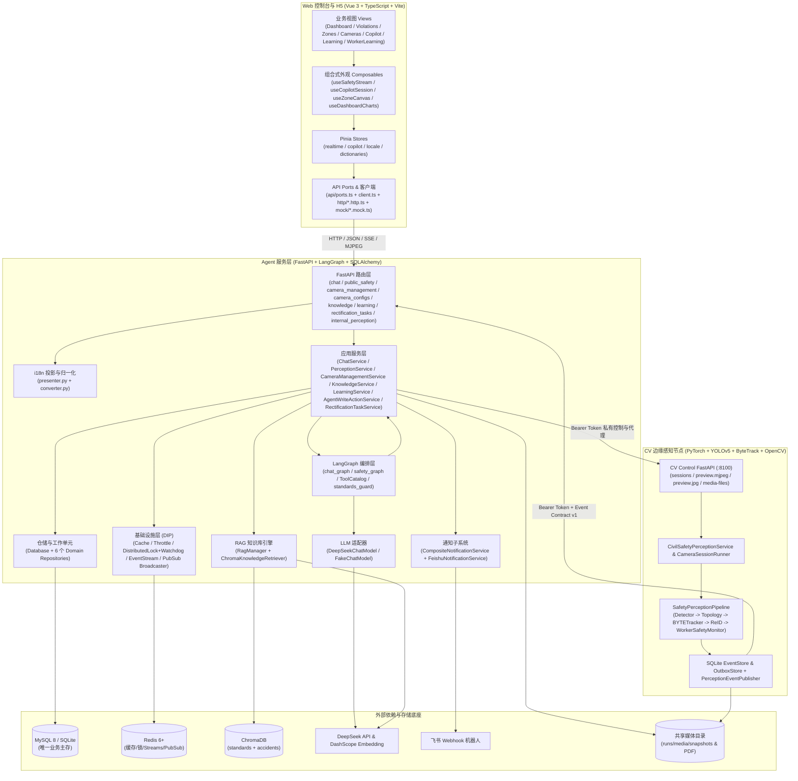

### 3.2 运行时部署拓扑图 (Deployment Diagram)

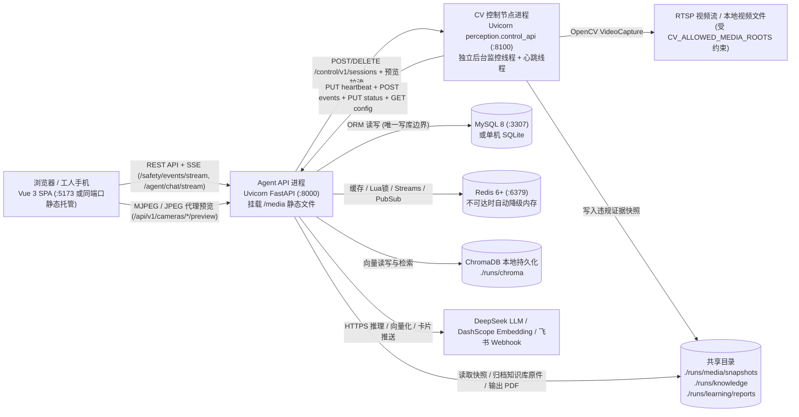

### 3.3 后端基础设施、通知、LLM 与工具类图 (Class Diagram)

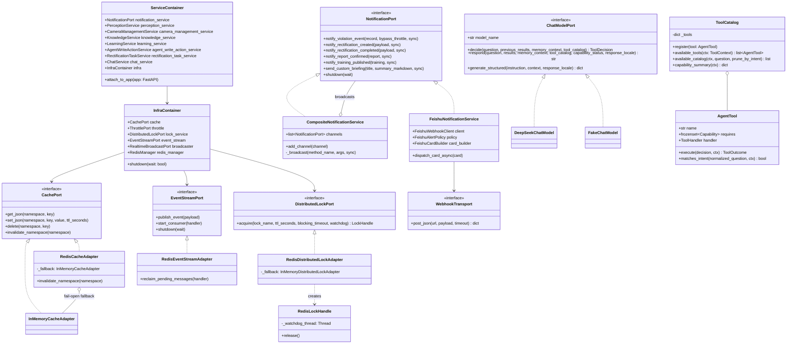

### 3.4 边缘 CV 感知子系统类图 (Class Diagram)

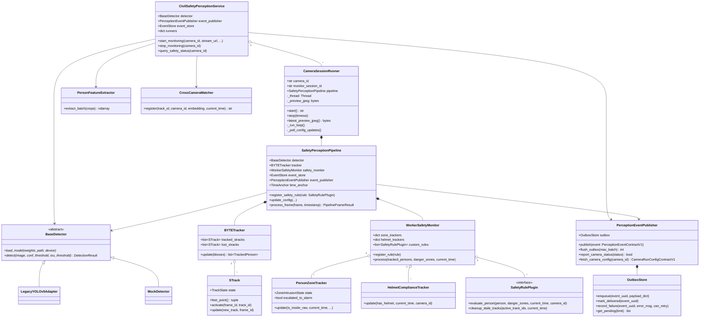

### 3.5 前端 API 依赖倒置与状态外观类图 (Class Diagram)

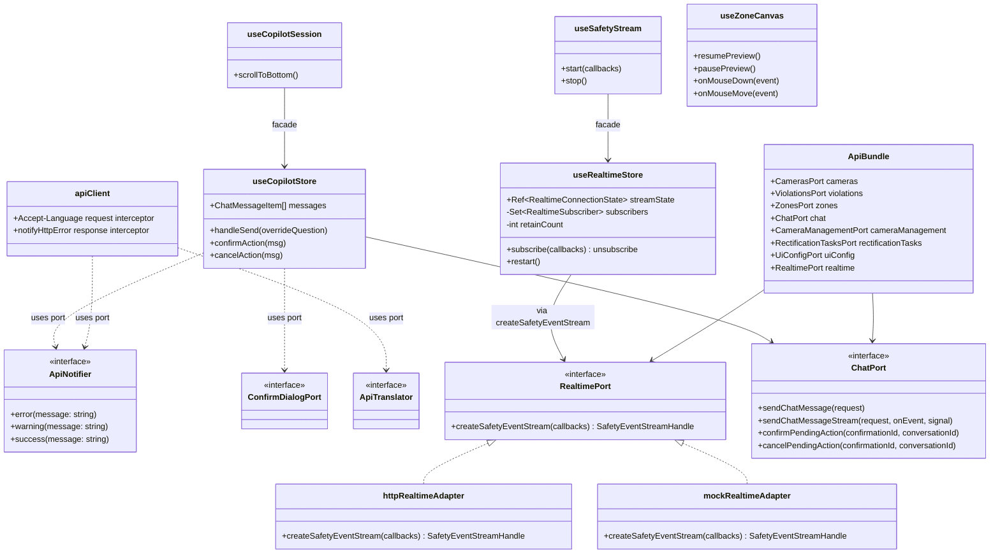

### 3.6 时序图一：CV 违规识别、幂等入库、Stream 削峰与 SSE/飞书告警

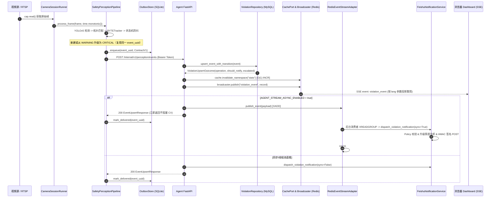

### 3.7 时序图二：Agent 流式问答、规范护栏与两阶段写操作确认

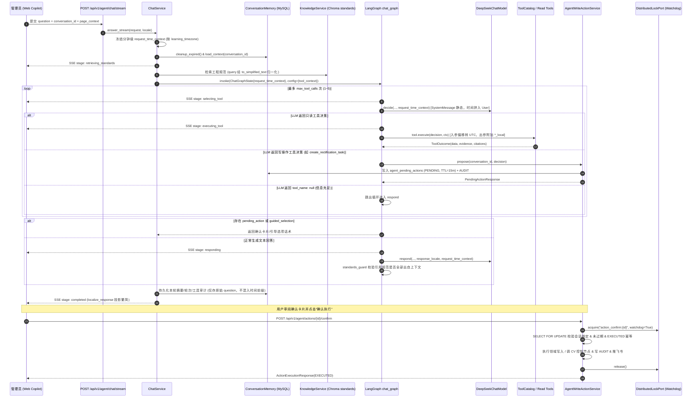

### 3.8 核心状态机图 (State Machine Diagrams)

#### A. CV 危险区域入侵与驻留超时状态机 (`PersonZoneTracker`)

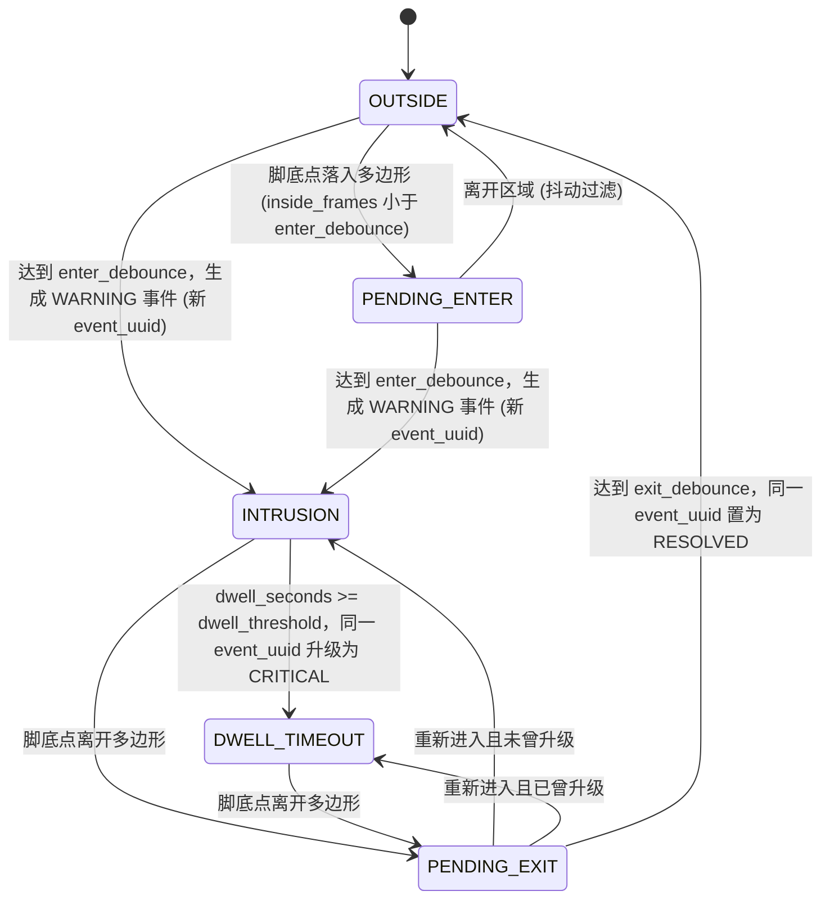

#### B. Agent 待确认写操作生命周期 (`AgentWriteActionService`)

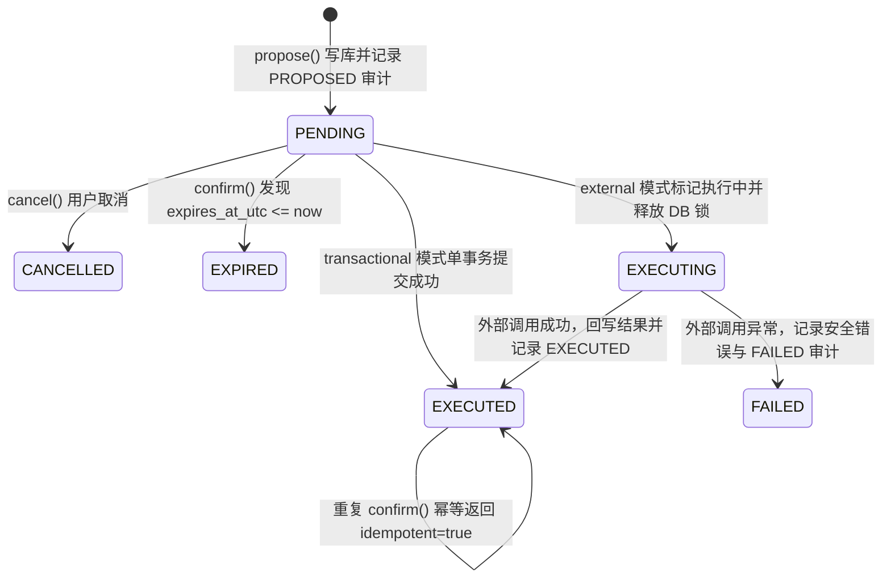

#### C. 知识文档版本生命周期 (`KnowledgeService`)

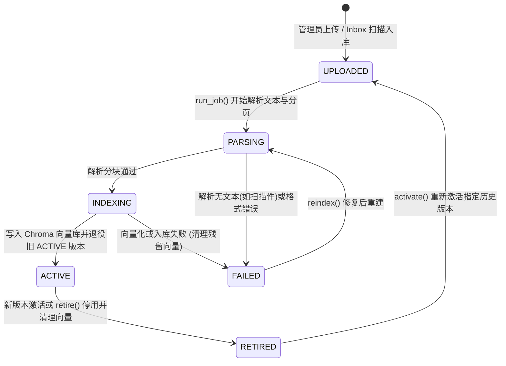

### 3.9 核心业务实体关系图 (ER Diagram)

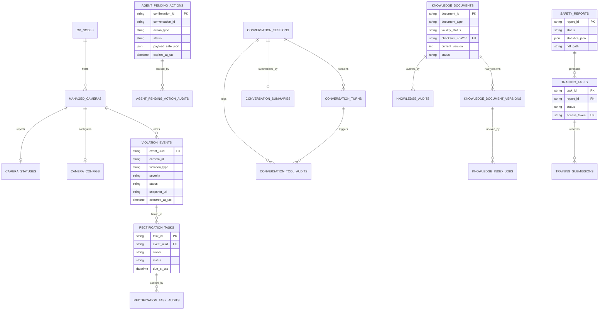
